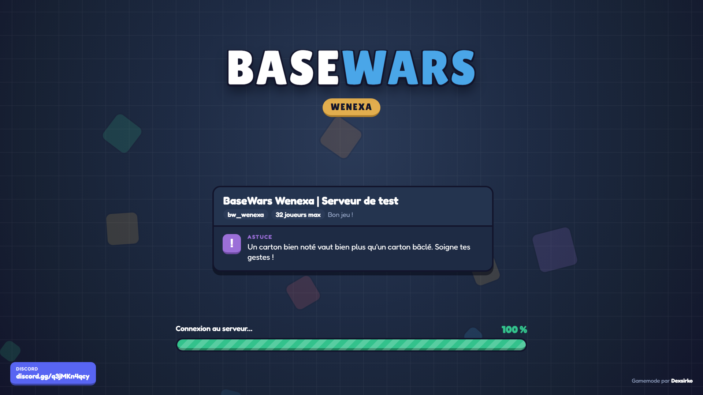

# BaseWars — écran de chargement

Écran de chargement du serveur Garry's Mod **BaseWars Wenexa** (gamemode par Dexsirko), hébergé sur GitHub Pages :
**https://dexsirko.github.io/basewars-loading/**



## Installer

Dans le `server.cfg` du serveur :

```
sv_loadingurl "https://dexsirko.github.io/basewars-loading/"
```

## Ce qu'il affiche

- Nom du serveur, carte et nombre de places, transmis par GMod (`GameDetails`).
- La progression réelle : fichiers à télécharger, fichier en cours, étape du chargement.
- Des astuces de jeu qui tournent, en français ou en anglais selon la langue du joueur.
- Le Discord : [discord.gg/q3jMKn4qcy](https://discord.gg/q3jMKn4qcy).

La page tourne aussi dans le vieux navigateur de la branche principale de GMod (Awesomium) : JS ES5, sans
flexbox ni variables CSS. Ouverte dans un navigateur normal, elle joue une démo du chargement.
